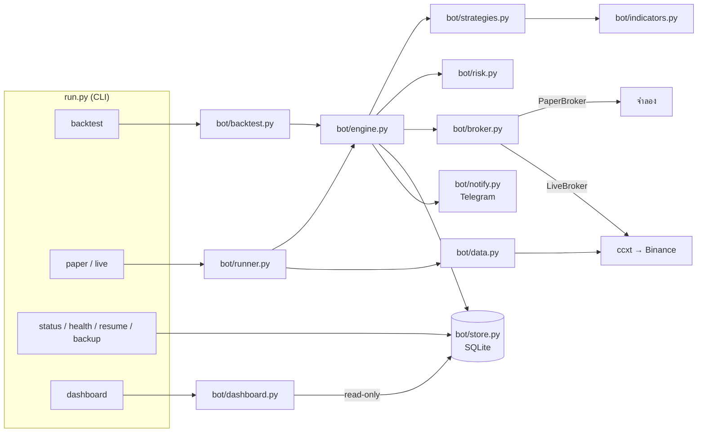
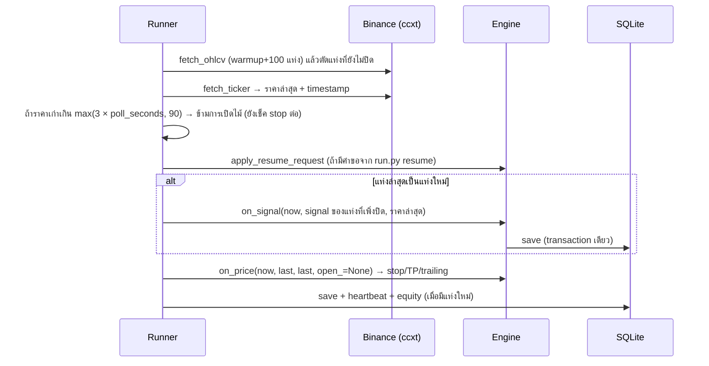
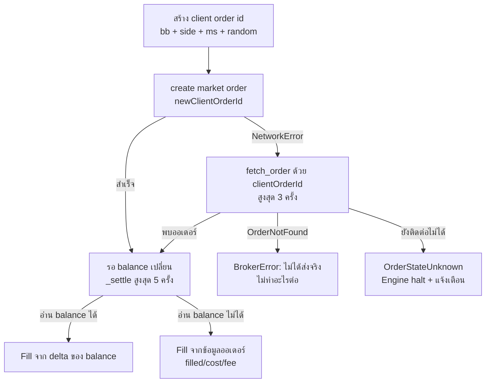

# สถาปัตยกรรม

## ภาพรวม

หลักการสำคัญ: **โค้ดตัดสินใจเทรดชุดเดียว (`Engine`) ใช้ร่วมกันทุกโหมด** — backtest, paper และ live ต่างกันแค่แหล่งราคา (`data`/backtester) และผู้ส่งคำสั่ง (`PaperBroker`/`LiveBroker`) ผล backtest จึงสะท้อนตรรกะเดียวกับของจริง

Venue (`bot/venues.py`) จับคู่ `exchange.name` กับ ccxt class และ prefix ของ API key (`BINANCE_*` / `BINANCEUS_*`) — `Runner.make_exchange()` และ `check_live_allowed()` ใช้ venue เดียวกันเสมอ ส่วน DB ได้ suffix venue เพื่อไม่ให้สอง venue ใช้ไฟล์เดียวกัน (ดู [CONFIGURATION.md](CONFIGURATION.md))

## โมดูล

| ไฟล์ | หน้าที่ | ขึ้นกับ |
|---|---|---|
| `run.py` | CLI: parse arguments, โหลด `.env` + config, เรียกคำสั่ง, คืน exit code | ทุกโมดูล (lazy import) |
| `bot/config.py` | `AppConfig` + โหลด/validate YAML, path ของ DB ตามโหมด, อ่าน API key, ประตูความปลอดภัยของ live (`check_live_allowed`) | `risk` |
| `bot/indicators.py` | EMA, RSI (Wilder) — เป็น causal ทั้งหมด (ใช้เฉพาะแท่งปัจจุบันและก่อนหน้า) | pandas |
| `bot/strategies.py` | กลยุทธ์ → สัญญาณต่อแท่ง `BUY=1 / SELL=-1 / HOLD=0`, registry `STRATEGIES` | `indicators` |
| `bot/risk.py` | `RiskConfig` (validate), `Position`, `RiskState`, `RiskManager` (sizing, SL/TP/trailing, daily loss, drawdown kill switch, halt/resume) | — |
| `bot/broker.py` | `PaperBroker` (จำลองค่าธรรมเนียม/slippage) และ `LiveBroker` (market order ผ่าน ccxt + การกู้ออเดอร์) พร้อมลำดับชั้น exception | ccxt |
| `bot/engine.py` | ตรรกะเข้า/ออก, จัดการ stop/TP/trailing, บันทึกสถานะ, จัดการ error ของ broker, halt/resume | `broker`, `risk`, `store`, `notify` |
| `bot/backtest.py` | วนทีละแท่งผ่าน `Engine` + `PaperBroker`, คำนวณสถิติ | `engine` |
| `bot/runner.py` | ลูป paper/live: ดึงแท่งเทียน, ตรวจแท่งใหม่, เรียก engine, heartbeat, จัดการ error/backoff, signal handling | ccxt, `engine`, `data` |
| `bot/data.py` | ดึง OHLCV แบบแบ่งหน้า, ตัดแท่งที่ยังไม่ปิด, โหลด CSV | pandas |
| `bot/store.py` | SQLite: ตาราง trades/state/equity, เขียนหลาย key ใน transaction เดียว, โหมด read-only | sqlite3 |
| `bot/notify.py` | ส่ง Telegram (ไม่บังคับ) + กันข้อความซ้ำ | urllib |
| `bot/dashboard.py` + `dashboard.html` | HTTP server (stdlib) แบบ read-only + หน้าเว็บ | `store` |

## Execution model

### Backtest (`bot/backtest.py`)

สำหรับแท่งที่ `i`:

1. `engine.on_signal(ts, pending, open[i], mark_price=close[i])` — สัญญาณที่คำนวณได้ตอน **ปิดแท่ง i-1** ถูกส่งคำสั่งที่ **ราคาเปิดแท่ง i** (เหมือนที่บอทจริงทำได้ ไม่มี lookahead) ส่วนการตรวจความเสี่ยง/kill switch ใช้ราคาปิดแท่งเพื่อให้ตรงกับกราฟ equity
2. `engine.on_price(ts, low[i], high[i], open_=open[i])` — ตรวจ stop/TP ภายในแท่ง:
   - ราคาเปิด gap ต่ำกว่า stop → ออกที่ราคาเปิด (`stop_gap`)
   - low แตะ stop → ออกที่ราคา stop (`stop_loss` หรือ `trailing_stop` ถ้า stop อยู่เหนือราคาเข้า)
   - ถ้าแท่งเดียวแตะทั้ง stop และ TP → **ถือว่าโดน stop ก่อน** (conservative)
   - เลื่อน trailing stop ด้วย high ของแท่ง แล้ว **เช็คซ้ำกับ low ของแท่งเดียวกัน** — ถ้า stop ใหม่ถูกทะลุให้ออกที่ stop ใหม่ทันที (ไม่อนุรักษ์นิยมเกินไปแบบเดิมที่รอแท่งถัดไป)
3. `pending = signals[i]` สำหรับแท่งถัดไป, บันทึก equity ที่ราคาปิด

### Paper / Live (`bot/runner.py`)

ทุก `poll_seconds` (`Runner.tick` → `Runner.step`):

- **รันครั้งแรก**: จำแท่งล่าสุดไว้เฉยๆ ไม่เทรดบนแท่งนั้น (กันการเข้าไม้จากสัญญาณเก่า)
- **สัญญาณ** คำนวณจากแท่งที่ปิดแล้วเท่านั้น (`drop_open_candle`)
- **Stop/TP** เช็คกับราคาล่าสุดทุกรอบ poll — ระหว่างรอบราคาอาจวิ่งผ่าน stop ได้ การออกจริงเป็น market order ที่ราคาตลาด ณ ตอนนั้น live ส่ง `open_=None` เสมอ ดังนั้นเหตุผลการออกจะเป็น `stop_loss`/`trailing_stop`/`take_profit` (ไม่ใช่ `stop_gap` ซึ่งใช้เฉพาะ backtest)
- ถ้า restore แล้วพบเหรียญ base ในกระเป๋าโดยไม่มี position บันทึกอยู่ (ซื้อแล้ว fill แต่สถานะยังไม่เซฟ / crash) บอทจะ **halt การเปิดไม้ใหม่** และแจ้งเตือนให้ตรวจบัญชีก่อน `resume`
- ถ้ามี position แต่จำนวนเหรียญในกระเป๋าต่างจากที่ track เกิน 1% (ยกเว้นกรณีหายเกินครึ่ง → เคลียร์ไม้แบบเดิม) ก็ halt เช่นกัน — กันการคำนวณด้วยขนาดไม้ที่ผิด
- ราคาจาก exchange ที่มี timestamp เก่ากว่า `max(3 × poll_seconds, 90)` ถือว่า stale: **ไม่ประมวลผลสัญญาณ/ไม่เปิดไม้ใหม่** และไม่ consume แท่งนั้น (รอราคาใหม่แล้วประมวลผลซ้ำ) แต่ยังเช็ค stop/TP ทุก poll

### การจัดการ error ในลูป (`Runner.tick`)

| Error | การตอบสนอง |
|---|---|
| `ccxt.AuthenticationError`, `AccountSuspended`, `BadSymbol` | แจ้งเตือน, **หยุดบอท**, exit code 3 (retry ไม่ช่วย) |
| `ccxt.NetworkError` (timeout, exchange ล่ม) → `transient` | retry แบบ backoff ×2 สูงสุด 600 วินาที |
| `RateLimitExceeded` / `DDoSProtection` → `rate_limited` | backoff อย่างน้อยตาม `retry-after` ที่ exchange ส่งมา ( capped 600 ) |
| `InsufficientFunds` / `InvalidOrder` → `rejected` | แจ้งเตือน แต่ **ไม่เพิ่ม backoff** (สั่งผิดจะไม่หายเองกลางลูป) |
| `ccxt.ExchangeError` อื่นๆ → `unknown` | แจ้งเตือน + backoff |
| Exception อื่นๆ ที่ไม่คาดคิด | log traceback, แจ้งเตือน, backoff — **ลูปไม่ตาย** เพื่อให้ stop ของไม้ที่เปิดอยู่ยังทำงาน |

การแยกประเภทอยู่ใน `bot/errors.py` (port pattern จาก zksato ภายใต้ MIT) — ดู [SECURITY.md](SECURITY.md#fail-closed-order-outcomes)

SIGINT/SIGTERM → ตั้ง flag หยุด, บันทึกสถานะ, ส่งข้อความ "bot stopped" แล้วออก

## การส่งคำสั่งแบบ live (`LiveBroker`)

- จำนวนเหรียญที่ได้วัดจาก **ส่วนต่าง balance** จึงรองรับค่าธรรมเนียมที่หักเป็นเหรียญ base หรือ BNB — `_settle` รอจนส่วนต่างตรงกับจำนวนที่ออเดอร์รายงานว่า fill แล้ว (**ไม่ใช่** เพียงยอดคงเหลือเปลี่ยนครั้งแรก จึงกัน partial fill/โอนเงินเข้าออกทำให้เข้าใจผิด)
- ถ้าส่งออเดอร์แล้วไม่รู้ผล (`OrderStateUnknown`) engine จะเก็บ client order id ไว้ใน position และพยายามค้นหาด้วย `fill_from_order()` ก่อนส่งขายใหม่ หากออเดอร์ fill จริงจะบันทึก sell/PnL ให้ครบ แทนที่จะปล่อยให้ position ถูกทิ้งแบบ `missing`
- ก่อนขาย: ถ้าในกระเป๋ามีเหรียญน้อยกว่าครึ่งของไม้ → `PositionMissingError`; ถ้ามูลค่าต่ำกว่าขั้นต่ำของตลาด → `DustError`
- ขายเฉพาะจำนวนที่บอทซื้อเอง ไม่แตะเหรียญเดิมของผู้ใช้

### ลำดับชั้น exception ของ broker

| Exception | ความหมาย | Engine ทำอะไร |
|---|---|---|
| `BrokerError` | คำสั่งไม่ได้ทำงาน บัญชีไม่เปลี่ยน (รวม rejection ที่ exchange ปฏิเสธชัดเจน) | log/แจ้งเตือน, ลองใหม่รอบหน้า (ตอนขาย) |
| `DustError` | ไม้เล็กกว่าขั้นต่ำ ขายไม่ได้ | เลิกติดตามไม้ (`abandon`/`dust`), เหรียญค้างในกระเป๋า |
| `PositionMissingError` | ไม่มีเหรียญของไม้ในกระเป๋าแล้ว | เลิกติดตามไม้ (`abandon`/`missing`) |
| `OrderStateUnknown` | ไม่รู้ว่าออเดอร์ทำงานหรือไม่ | **halt** การเปิดไม้ใหม่ ต้อง `resume` เอง |

## สถานะและการเก็บข้อมูล (`bot/store.py`)

ไฟล์ DB แยกตามโหมด จาก `db_path` (ค่าเริ่มต้น `data/bot.db`):

| โหมด | ไฟล์ |
|---|---|
| paper | `data/bot.paper.db` |
| live + `testnet: true` | `data/bot.live.testnet.db` |
| live + `testnet: false` | `data/bot.live.db` |

Backtest ใช้ DB ในหน่วยความจำ (ไม่เขียนไฟล์)

### ตาราง

| ตาราง | คอลัมน์ | หมายเหตุ |
|---|---|---|
| `trades` | `id, ts, mode, symbol, side, qty, price, quote, reason, pnl_quote, order_id` | `side`: `buy` / `sell` / `abandon`; `reason`: `signal`, `stop_loss`, `stop_gap`, `trailing_stop`, `take_profit`, `dust`, `missing` |
| `state` | `k, v` (JSON) | ดูตารางด้านล่าง |
| `equity` | `ts, equity, price` | หนึ่งแถวต่อแท่งเทียน ใช้วาดกราฟ |

### State keys

| Key | เนื้อหา | ผู้เขียน |
|---|---|---|
| `position` | `Position` ปัจจุบันหรือ `null` (รวม `pending_order_id` ถ้าส่งขายแล้วยังไม่รู้ผล) | Engine |
| `risk` | `RiskState` (day, day_start_equity, trades_today, last_exit_bar, halted_reason, peak_equity) | Engine |
| `bar_index` | ตัวนับแท่ง (ใช้กับ cooldown) | Engine |
| `paper_balances` | `[base, quote]` (paper เท่านั้น) | Engine |
| `last_bar` | timestamp ของแท่งล่าสุดที่ประมวลผลแล้ว | Runner |
| `start_equity` | equity ตอนเริ่มครั้งแรก | Runner |
| `heartbeat` | ts, price, equity, balances, symbol, mode, halted ฯลฯ | Runner |
| `resume_requested` | มีค่าเมื่อสั่ง `run.py resume` แล้วยังไม่ถูกนำไปใช้ | CLI → Engine ลบเมื่อใช้แล้ว |

`position`, `risk`, `bar_index`, `paper_balances` ถูกเขียน **ใน transaction เดียว** (`Store.put_many`) — crash ระหว่างทางไม่ทำให้สถานะขัดกัน DB ใช้ WAL mode ให้ dashboard อ่านได้พร้อมกับที่บอทเขียน

## Dashboard

- โปรเซสแยกจากบอท เปิด DB ด้วย SQLite URI `mode=ro` — **เขียนไม่ได้และส่งคำสั่งเทรดไม่ได้**
- ใช้ `http.server` ของ stdlib (ไม่มี dependency เพิ่ม), หน้าเว็บ render ด้วย `textContent` (กัน XSS)
- สถานะบอท: `online` ถ้า heartbeat ใหม่กว่า `max(3 × poll_seconds, 90)` วินาที, ไม่งั้น `stale`; ไม่มี heartbeat = `offline`
- Endpoint ทั้งหมดดูที่ [CLI.md](CLI.md#dashboard-http-api)
